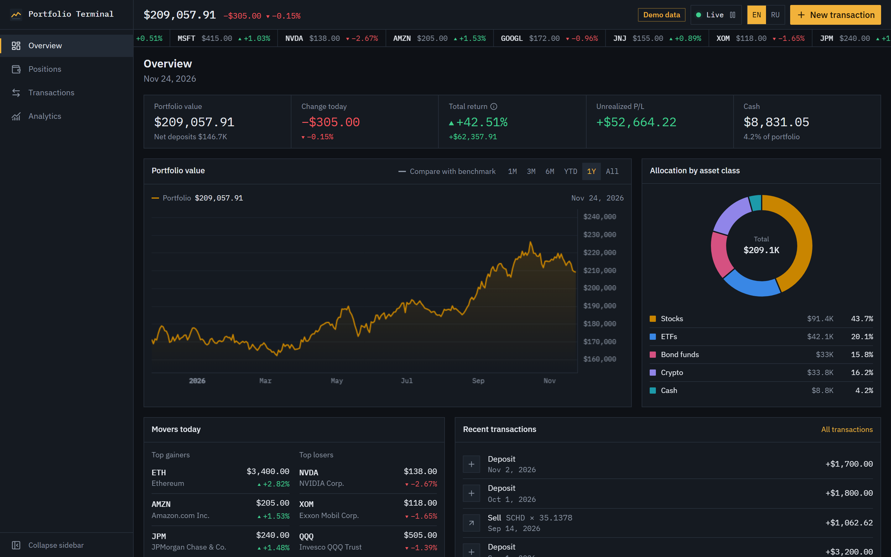
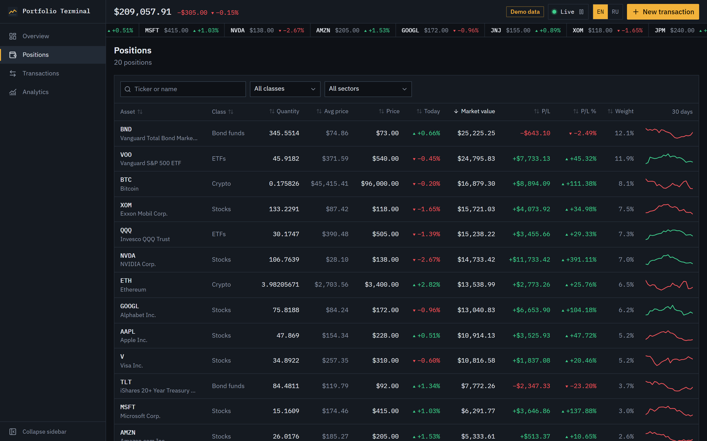
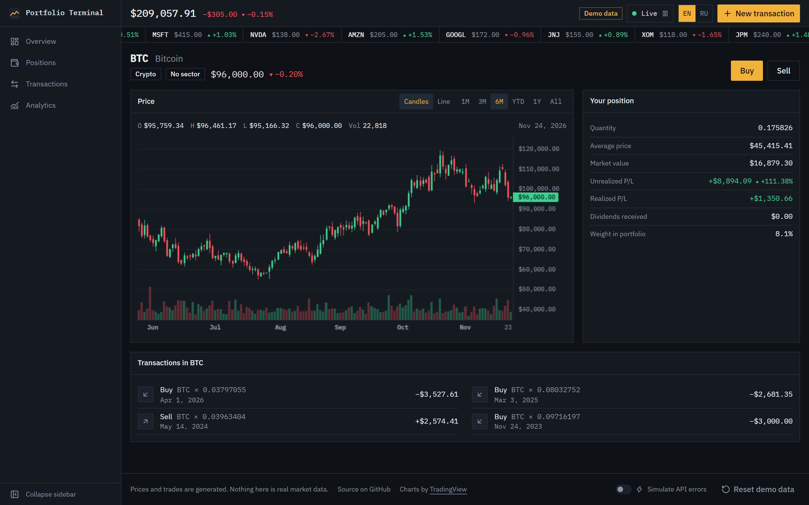
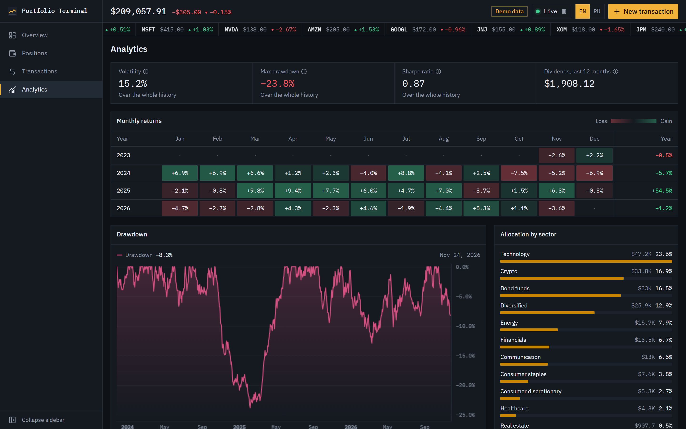
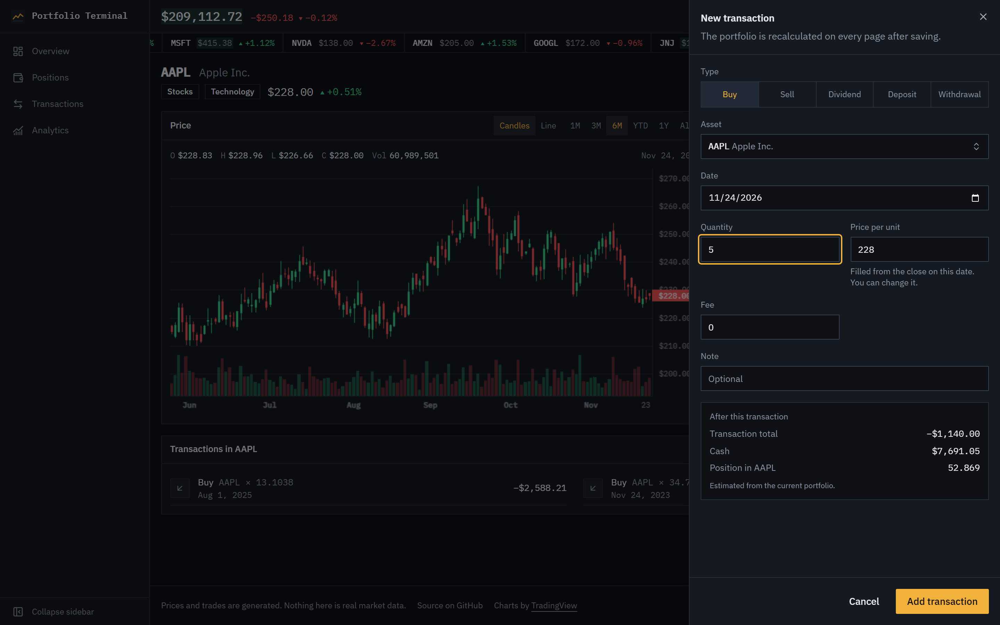
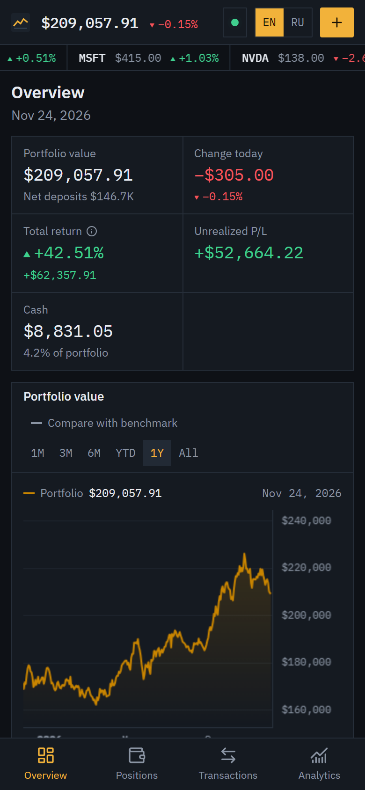

# Portfolio Terminal

**English** · [Русский](README.ru.md)

An investment portfolio dashboard in a dark "trader terminal" style. It runs entirely in the browser on deterministic demo data: no sign-up, no API keys, nothing that can go down.

**Live demo:** https://portfolio-terminal.vercel.app



## Features

- **Overview** — portfolio value, day change, simple total return, unrealized P/L and cash; value chart with periods and an honest benchmark comparison; allocation by asset class; top movers; recent transactions.
- **Live prices** — a simulated feed ticks every 2–4 seconds; prices flash green/red and every derived number (value, P/L, weights, day change) is recalculated. Pause button, auto-pause in a hidden tab, no flashes with `prefers-reduced-motion`.
- **Positions** — sortable table with search, class and sector filters, totals row, 30-day sparklines; sticky first column on phones.
- **Asset page** — candlestick chart with volume and OHLC legend, candles/line toggle, position block, transactions in the asset, Buy/Sell shortcuts.
- **Transactions** — server-side pagination, sorting and filters kept in the URL (shareable links), edit, delete with confirmation, CSV export of the current selection.
- **Transaction form** — buy, sell, dividend, deposit, withdrawal; fields depend on the type; price filled from the close on the chosen date; live preview of cash and position after the trade; validation on the client and on the "server", including ledger integrity (you cannot delete a buy that a later sale depends on).
- **Analytics** — monthly returns heatmap, drawdown chart, volatility, max drawdown and Sharpe ratio with plain-language formulas, allocation by sector, dividends by month.
- **RU/EN** — every string, number, currency and date switches instantly.
- **Keyboard** — `N` new transaction, `/` search the current table, `?` list of shortcuts.
- **Chaos mode** — opt-in API error simulation (`?chaos=1` or the footer switch) to show retries and error states. Off by default.

| Positions                                    | Asset                                | Analytics                                    |
| -------------------------------------------- | ------------------------------------ | -------------------------------------------- |
|  |  |  |

| Transaction form                                           | Mobile                                                             |
| ---------------------------------------------------------- | ------------------------------------------------------------------ |
|  |  |

## Stack

React 19 · TypeScript (strict, no `any`) · Vite · React Router · TanStack Query · TanStack Table v9 · Zustand · MSW · Tailwind CSS v4 + shadcn/ui · TradingView Lightweight Charts · Recharts · React Hook Form + Zod · i18next · date-fns · Vitest + Testing Library · Playwright + axe · ESLint + Prettier · GitHub Actions.

## Architecture decisions

**Why a fake API (MSW) instead of static JSON.** The app talks to `/api/*` over real `fetch`, so loading states, caching, retries, optimistic updates, pagination and 422 validation errors are all exercised honestly. A Service Worker answers those requests in the browser — in development _and_ in production — with 200–700 ms latency. The demo never depends on a third-party service.

**One source of truth for the math.** All financial calculations are pure functions in `src/shared/lib/finance`, covered by unit tests. The MSW handlers compute summaries, positions, history and analytics with the same functions the UI uses for live repricing and client-side validation.

**Derived, not stored.** Positions, cash and portfolio value are never stored. They are replayed from the transaction ledger and prices every time, so the portfolio P/L always reconciles with the sum of the rows (a test checks `total return = unrealized + realized P/L + dividends`).

**How P/L is calculated.**

- Average cost: a buy adds `quantity × price + fee` to the cost basis; a sale keeps the average price and realizes `(sale price − average price) × quantity − fee`.
- Unrealized P/L = market value − quantity × average price. Day change uses the previous close.
- Total return is simple: (current value − net deposits) / net deposits. TWR is out of scope.
- Monthly returns, drawdown, volatility (σ of daily returns × √252) and Sharpe (4% risk-free rate) use daily returns **net of deposits and withdrawals**, so a deposit never looks like growth and cannot hide a loss.
- The benchmark on the value chart receives the same deposits and withdrawals on the same days, which makes the comparison fair.

**Deterministic demo data.** A seeded generator builds about three years of daily candles ending today (geometric Brownian motion with market factors and scripted regimes, so drawdowns are guaranteed), a synthetic benchmark and ~135 consistent transactions. User changes are stored in `localStorage` as a layer (added / updated / deleted) on top of the generated ledger and re-validated on every start.

**Structure.**

```
src/
  app/        providers, router, layout (sidebar, header, ticker tape), styles
  pages/      overview, positions, asset, transactions, analytics, not-found
  features/   transaction-form, price-feed, hotkeys, locale-switch, demo-reset, chaos-mode
  entities/   asset, portfolio, transaction — query hooks and small UI pieces
  shared/     api (http client, contracts, query keys), lib (finance, formatters),
              i18n, ui (shadcn components, charts, table), store, model (domain types)
  mocks/      seeded generator, in-memory db, persistence layer, MSW handlers
```

Pages load lazily; chart libraries and the transaction form are separate chunks; the fake API is a lazy chunk too.

**Design.** Graphite surfaces, one amber accent, green and red reserved for gains and losses (always paired with `+/−` and ▲▼). The chart palette is a set of design tokens validated for dark mode and color-vision deficiency. IBM Plex Sans and Mono are self-hosted; all numbers use tabular figures.

## Quality

- 260+ unit and component tests (Vitest + Testing Library): every finance function, ledger validation, generator consistency for several "today" dates, formatters in both locales, the transaction form, table sorting and filtering, language switching, live repricing.
- E2E smoke on the production build (Playwright): overview → buy through the form → position and cash change → delete → back to the start; language switch; asset page; axe check for WCAG 2.1 AA on every page.
- Lighthouse (desktop): performance 98, accessibility 100, best practices 100.
- CI on every push and PR: lint → format → typecheck → unit → build → e2e.

## Getting started

Requires Node.js 22+.

```bash
npm install
npm run dev
```

| Command                             | What it does                                                                         |
| ----------------------------------- | ------------------------------------------------------------------------------------ |
| `npm run dev`                       | Dev server                                                                           |
| `npm run build`                     | Typecheck + production build                                                         |
| `npm run preview`                   | Serve the production build                                                           |
| `npm run lint` / `npm run format`   | ESLint / Prettier                                                                    |
| `npm run typecheck`                 | `tsc --noEmit`                                                                       |
| `npm run test` / `npm run test:run` | Vitest in watch / single-run mode                                                    |
| `npm run test:e2e`                  | Playwright smoke (run `npm run build` first; `npx playwright install chromium` once) |
| `npm run screenshots`               | Regenerate README screenshots and the Open Graph image                               |

## Deployment

Vercel, as a static SPA: `vercel.json` rewrites every route to `index.html` and leaves static files (including `mockServiceWorker.js`) alone. Set `VITE_SITE_URL` to the public URL for absolute Open Graph links.

## Credits

Financial charts by [TradingView Lightweight Charts](https://www.tradingview.com/) (Apache 2.0). Prices and trades in the demo are generated and are not market data.
