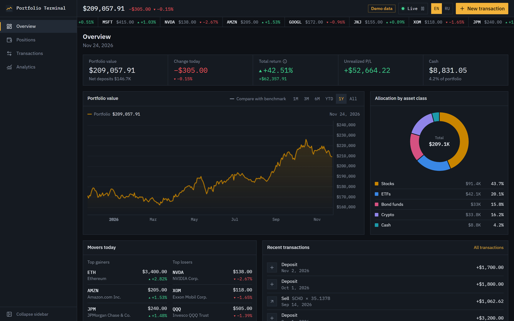
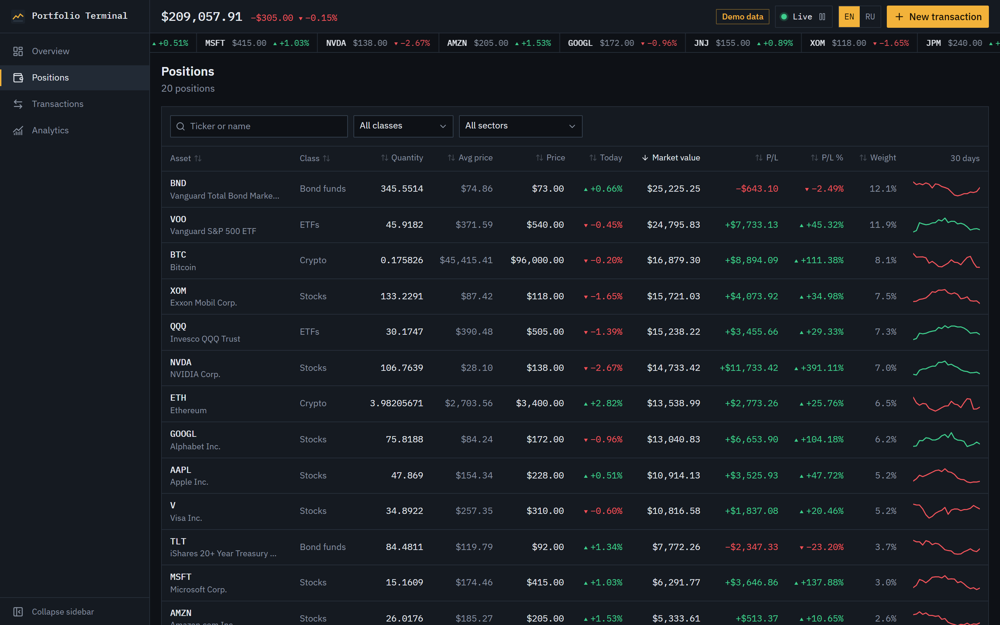
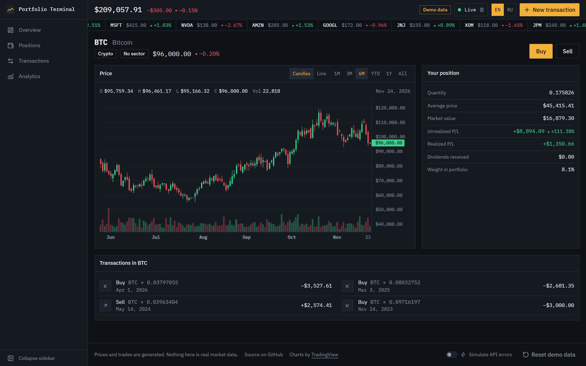
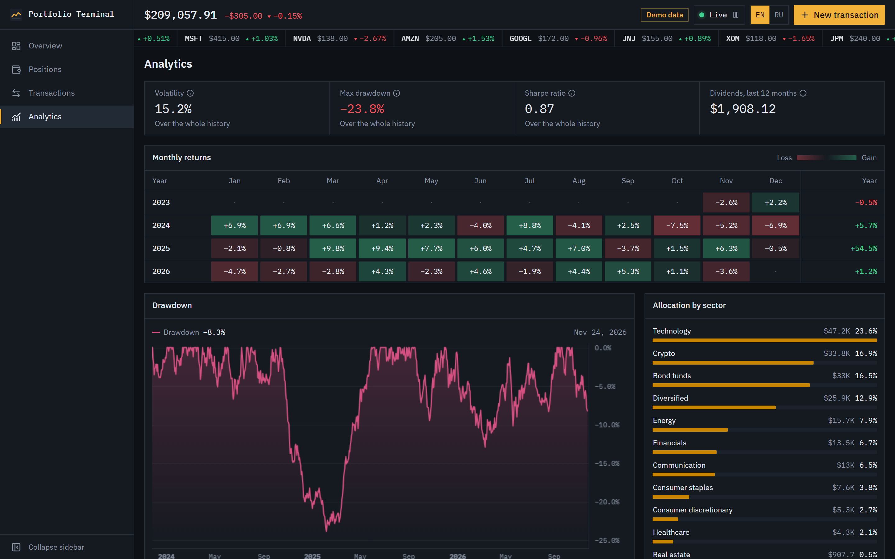
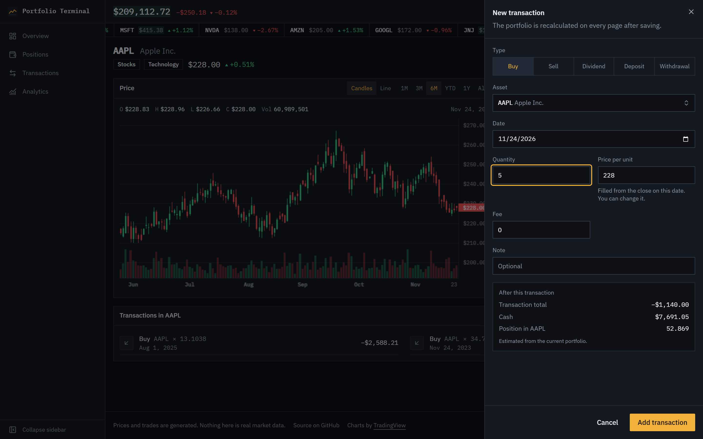
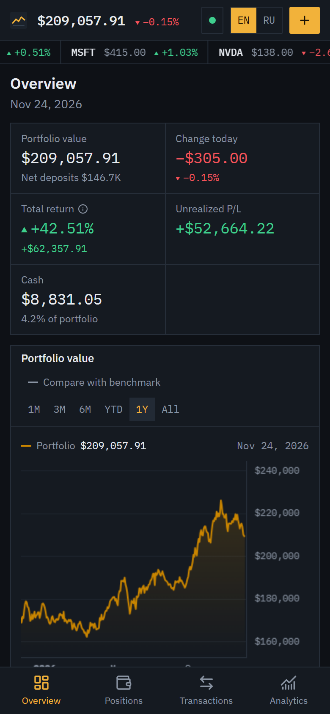

# Portfolio Terminal

[English](README.md) · **Русский**

Дашборд инвестиционного портфеля в тёмном стиле «терминала трейдера». Работает целиком в браузере на детерминированных демо-данных: без регистрации, без ключей API и без внешних сервисов, которые могут упасть.

**Демо:** https://portfolio-terminal-df33.vercel.app



## Возможности

- **Обзор** — стоимость портфеля, изменение за день, простая общая доходность, нереализованный P/L и кэш; график стоимости с периодами и честным сравнением с бенчмарком; распределение по классам активов; лидеры роста и падения; последние сделки.
- **Live-цены** — имитация потока котировок: каждые 2–4 секунды цены меняются и вспыхивают зелёным или красным, а все производные цифры (стоимость, P/L, веса, изменение за день) пересчитываются. Кнопка паузы, автопауза в скрытой вкладке, без вспышек при `prefers-reduced-motion`.
- **Позиции** — таблица с сортировкой, поиском, фильтрами по классу и сектору, итоговой строкой и спарклайнами за 30 дней; на телефоне первая колонка закреплена.
- **Страница актива** — свечной график с объёмами и OHLC-легендой, переключатель «свечи/линия», блок позиции, сделки по активу, кнопки «Купить» и «Продать».
- **Сделки** — серверная пагинация, сортировка и фильтры в URL (ссылкой можно поделиться), редактирование, удаление с подтверждением, экспорт текущей выборки в CSV.
- **Форма сделки** — покупка, продажа, дивиденд, пополнение, вывод; поля зависят от типа; цена подставляется из закрытия на выбранную дату; предпросмотр кэша и позиции после сделки; валидация на клиенте и на «сервере», включая целостность леджера (нельзя удалить покупку, от которой зависит более поздняя продажа).
- **Аналитика** — тепловая карта месячной доходности, график просадки, волатильность, максимальная просадка и коэффициент Шарпа с формулами простыми словами, распределение по секторам, дивиденды по месяцам.
- **RU/EN** — все тексты, числа, валюты и даты переключаются мгновенно.
- **Клавиатура** — `N` новая сделка, `/` поиск в текущей таблице, `?` список клавиш.
- **Режим хаоса** — имитация ошибок API по запросу (`?chaos=1` или переключатель в подвале), чтобы показать повторы и состояния ошибок. По умолчанию выключен.

| Позиции                                    | Актив                                | Аналитика                                    |
| ------------------------------------------ | ------------------------------------ | -------------------------------------------- |
|  |  |  |

| Форма сделки                                           | Телефон                                                             |
| ------------------------------------------------------ | ------------------------------------------------------------------- |
|  |  |

## Стек

React 19 · TypeScript (strict, без `any`) · Vite · React Router · TanStack Query · TanStack Table v9 · Zustand · MSW · Tailwind CSS v4 + shadcn/ui · TradingView Lightweight Charts · Recharts · React Hook Form + Zod · i18next · date-fns · Vitest + Testing Library · Playwright + axe · ESLint + Prettier · GitHub Actions.

## Архитектурные решения

**Почему фейковый API (MSW), а не статический JSON.** Приложение ходит в `/api/*` настоящим `fetch`, поэтому загрузка, кэш, повторы, оптимистичные обновления, пагинация и ошибки валидации 422 работают честно. Запросы обслуживает Service Worker прямо в браузере — и в разработке, и в production — с задержкой 200–700 мс. Демо не зависит от сторонних сервисов.

**Один источник правды для расчётов.** Все финансовые расчёты — чистые функции в `src/shared/lib/finance`, покрытые unit-тестами. Обработчики MSW считают сводку, позиции, историю и аналитику теми же функциями, которыми UI пересчитывает портфель от live-цен и проверяет форму.

**Производные, а не хранимые данные.** Позиции, кэш и стоимость не хранятся: каждый раз они вычисляются из леджера сделок и цен, поэтому P/L портфеля всегда сходится с суммой по строкам (тест проверяет `общая доходность = нереализованный + реализованный P/L + дивиденды`).

**Как считается P/L.**

- Средняя стоимость: покупка добавляет к стоимости позиции `количество × цена + комиссия`; продажа не меняет среднюю цену и фиксирует `(цена продажи − средняя цена) × количество − комиссия`.
- Нереализованный P/L = рыночная стоимость − количество × средняя цена. Изменение за день — к закрытию предыдущего дня.
- Общая доходность простая: (текущая стоимость − чистые вложения) / чистые вложения. TWR вне объёма.
- Месячная доходность, просадка, волатильность (σ дневных доходностей × √252) и Шарп (безрисковая ставка 4%) считаются по дневным доходностям **за вычетом пополнений и выводов**: пополнение не выглядит как рост и не прячет убыток.
- Бенчмарк на графике стоимости получает те же пополнения и выводы в те же дни — сравнение честное.

**Детерминированные демо-данные.** Генератор с фиксированным seed строит около трёх лет дневных свечей, заканчивающихся сегодняшней датой (геометрическое броуновское движение с рыночными факторами и заданными режимами, поэтому просадки есть всегда), синтетический бенчмарк и около 135 согласованных сделок. Изменения пользователя хранятся в `localStorage` слоем (добавленные / изменённые / удалённые) поверх сгенерированного леджера и перепроверяются при каждом запуске.

**Структура.**

```
src/
  app/        провайдеры, роутер, каркас (сайдбар, шапка, бегущая строка), стили
  pages/      overview, positions, asset, transactions, analytics, not-found
  features/   transaction-form, price-feed, hotkeys, locale-switch, demo-reset, chaos-mode
  entities/   asset, portfolio, transaction — хуки запросов и небольшие UI-части
  shared/     api (http-клиент, контракты, query keys), lib (финансы, форматтеры),
              i18n, ui (компоненты shadcn, графики, таблица), store, model (доменные типы)
  mocks/      генератор с seed, in-memory база, слой persistence, обработчики MSW
```

Страницы грузятся лениво; библиотеки графиков и форма сделки — отдельные чанки; фейковый API — тоже ленивый чанк.

**Дизайн.** Графитовые поверхности, один янтарный акцент, зелёный и красный только для роста и падения (всегда вместе с `+/−` и ▲▼). Палитра графиков задана токенами и проверена для тёмной темы и для дальтонизма. Шрифты IBM Plex Sans и Mono подключены локально; все числа — с табличными цифрами.

## Качество

- 260+ unit- и компонентных тестов (Vitest + Testing Library): все финансовые функции, валидация леджера, консистентность генератора для разных «сегодня», форматтеры в обеих локалях, форма сделки, сортировка и фильтры таблицы, переключение языка, пересчёт от live-цен.
- E2E-смоук на production-сборке (Playwright): обзор → покупка через форму → позиция и кэш изменились → удаление → всё вернулось; переключение языка; страница актива; проверка axe на WCAG 2.1 AA для каждой страницы.
- Lighthouse (desktop): производительность 98, доступность 100, best practices 100.
- CI на каждый push и PR: lint → format → typecheck → unit → build → e2e.

## Запуск

Нужен Node.js 22+.

```bash
npm install
npm run dev
```

| Команда                             | Что делает                                                                             |
| ----------------------------------- | -------------------------------------------------------------------------------------- |
| `npm run dev`                       | Dev-сервер                                                                             |
| `npm run build`                     | Проверка типов + production-сборка                                                     |
| `npm run preview`                   | Отдать production-сборку                                                               |
| `npm run lint` / `npm run format`   | ESLint / Prettier                                                                      |
| `npm run typecheck`                 | `tsc --noEmit`                                                                         |
| `npm run test` / `npm run test:run` | Vitest в режиме наблюдения / один прогон                                               |
| `npm run test:e2e`                  | Смоук Playwright (сначала `npm run build`; один раз `npx playwright install chromium`) |
| `npm run screenshots`               | Пересоздать скриншоты README и картинку Open Graph                                     |

## Деплой

Vercel, как статический SPA: `vercel.json` перенаправляет все маршруты на `index.html` и не трогает статические файлы (включая `mockServiceWorker.js`). Переменная `VITE_SITE_URL` — публичный адрес для абсолютных ссылок Open Graph.

## Благодарности

Финансовые графики — [TradingView Lightweight Charts](https://www.tradingview.com/) (Apache 2.0). Цены и сделки в демо сгенерированы и не являются рыночными данными.
